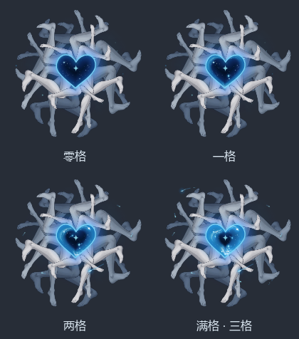

# Blue-Star Pet

当前版本：**v1.1.0** · [版本说明](docs/releases/v1.1.0.md) · [所有版本](#all-releases)

**本项目完全由 Codex 制作。**

以 Project Moon《脑叶公司》中的异想体「碧蓝新星」为原型，用 WPF 制作的 Windows 同人桌宠。点一下心核，它会发出「新星之声」。环绕心核的小星星也可以用来暂存文件，方便稍后拖到目标文件夹。

> 本桌宠为非官方同人项目，与游戏开发商 Project Moon 无隶属或合作关系。「碧蓝新星」的原作设定，以及本项目引用的《脑叶公司》《废墟图书馆》游戏音频等原作素材，其相关权利归 Project Moon 及相应权利人所有。


## 下载与运行

1. 打开 [最新版本](https://github.com/LuminousQuill/Blue-Star-Pet/releases/latest)，下载 `Blue-Star-Pet-Windows.zip`。
2. 将 ZIP 解压到想要保留桌宠的文件夹，双击 `BlueStar.exe`。
3. 首次启动时，桌宠会出现在桌面右下方。按住左键可拖动它，右键单击可打开「工作指令」。

### 从旧版升级

先通过「本能 → 退出桌宠」关闭旧版，再解压新版 ZIP，覆盖原位置的 `BlueStar.exe`。建议保留原来的文件夹路径；程序使用 Windows/.NET 的用户设置存储，换到新目录可能使位置、音量、充能等设置回到默认值。星轨暂存记录不会跨进程保存，退出后原文件仍在原处。

运行环境为 64 位 Windows 和 .NET Framework/WPF；当前版本在 Windows 11 上完成验收。下载包无需安装额外的图像或音效文件，也不包含个人设置。

### v1.1.0 新增与修复

- 三格持久充能、大共鸣、晶体/星空心核，以及按回收文件大小变化的吸收回弹。
- 辐射/台座腿型，媒体与已有窗口的钉住参照、协同拖动和缩放。
- 修复不同缩放比例的多屏共鸣波心偏移、窗口扩张跳位、台座压迫收脚和夹持缩放回摆。
- 更新充能升级、彗星星闪和大共鸣音效，并优化常驻动画分配与波纹绘制。

## 工作指令

| 指令 | 用法 |
| --- | --- |
| 本能 | 调整互动音效、总音量和桌宠大小，选择晶体或星空心核，切换置顶、自行移动或登录 Windows 时启动，也可以在这里打开回收站或退出桌宠。「腿部分布」可选「辐射」（默认）或「台座」，切换后立即生效并保存。 |
| 洞察 | 设置观测倒计时。可选 5、15、25 分钟或自行输入分秒。关闭面板后继续计时，到时心核会释放一次「新星之声」。 |
| 沟通 | 「请求归还」尝试从回收站找回最近吸入的一批文件，恢复到原位置，并在星轨上显示。**「回归星之怀抱」会清空整个 Windows 回收站，包括通过其他程序删除的项目。** |
| 压迫 | 封住心核，将星轨收拢成列表。此时把文件放在心核上即可暂存。单击心核可解除封印。 |

## 大共鸣

桌宠运行时，心核每积满 600 个有效秒升一格。平时每秒积 1 秒，洞察期间每秒积 2 秒，提前取消也保留已积的时间。洞察到时会释放一次小共鸣。每成功回收一个文件另加 60 个有效秒，文件夹按其中实际回收的文件数计算。空文件夹、投递失败和暂存操作都不增加这项奖励。

一次投递可以连升多格。升级时，心核先暗下来，两道亮边沿心瓣汇到心尖，短暂停住后中央星芒迸亮，对应的充能刻度随之点亮。等级和格内进度会随设置保存。三格满充后停止累积，消耗大共鸣后从零重新计时。

在「本能 → 心核风格」中可以随时切换材质。默认的晶体有冰蓝色切面。星空风格的青蓝心壳里，星尘沿着心瓣缓缓漂移，几处较亮的星尘之间留有深蓝空隙。壳的内缘柔和地过渡到暗心，中央悬着四角星。零格时星光较淡，一格时薄边增厚为一圈蓝色液壳。两格时，一颗银蓝流星带着短尾掠过心瓣。满格的壳最厚，心尖每隔几秒聚光一次，再沿两侧散出星屑。选择会在下次启动时恢复。



_程序渲染预览：星空心核随充能逐步增亮，不是整屏桌面截图。_

| 充能 | 晶体心核状态 |
| --- | --- |
| 0 · 沉寂 | 黑色心核中只有中央四角星。 |
| 1 · 初明 | 心核凝出一圈薄冰，单缕银光沿整圈缓缓游走。一颗小星绕着中央星芒运行。 |
| 2 · 双引 | 冰蓝外壳加厚，完整包住两瓣和心尖。两束光沿左右心瓣向下游动，两颗小星相对绕行，银蓝星屑从腿间穿过。 |
| 3 · 满相 | 青色晶壳最厚，包住深蓝内心。两侧的光在心尖汇合，三颗小星围着中央星芒运行，外围多出一层反向绕行的星屑。两颗外围八尖星持续可见，各自周期性地闪亮、收小。 |

满充后，下一次轻点心核，或通过「沟通 → 回归星之怀抱」成功清空回收站，会消耗三格充能发动大共鸣。星屑向心核内坠，蓄力末期桌面局部折射。发波瞬间，腿围绕心核向四面伸直、脚尖勾起。波前扫过桌宠所在的显示器，在边缘反弹。背景音持续 10 秒，从第 7 秒起淡出。系统外部清空回收站触发普通共鸣，保留充能。

## 文件暂存与回收

- **暂存文件**时，从资源管理器拖住文件或文件夹，在 5 秒内沿同一方向绕心核约两圈，看到「已暂存」即可松手。每颗星代表一批文件，记录的是原路径。退出桌宠后，星轨上的暂存记录会消失，原文件仍在原处。
- **取用文件**时，把星星拖到目标文件夹可移动整批文件。要单独移动一项，先单击星星展开列表，再将该项拖出。列表中的「释放」会取消整批暂存，文件保留在原位置。
- **回收文件**前，先确认心核已解除封印，再把文件或星星拖到心核中央松手，文件会移入 Windows 回收站。需要撤销时可用「沟通 → 请求归还」。如果原位置已有同名项目，桌宠会跳过该项。也可通过「本能 → 打开回收站」查看和还原。
- **吸收时的回弹**按本批成功回收的总大小分为小于 100 MiB、100 MiB 至不足 500 MiB、500 MiB 至不足 1 GiB、1 GiB 及以上四档。回收成功时，心核立即向外膨胀，再回到平时大小。档位越高，膨胀幅度越大。例如，一个 1 GiB 文件会触发最强回弹并增加 60 个有效秒。十个合计不足 100 MiB 的文件会触发最轻回弹，并增加一格充能。

## 钉住参照

从资源管理器拖住一张图片、一段音频或一个视频，直接放到碧蓝新星的腿上。看到「松手钉住参照」就松手，Windows 会用默认应用打开媒体，两只脚会夹住窗口边缘。已经暂存的单文件小星也可以这样拖。每次可以夹住一个窗口，夹持期间两者一起置顶，自行游荡暂停。

对于已经打开的资源管理器文件夹、图片查看器或播放器，按住标题栏移动窗口，让任意一条边或一个角靠近脚尖，并按住停留 1.5 秒。两点青光沿边框向夹点汇聚，遇到窗口角会沿着拐角转弯。中途移开或松手会取消。四角星亮起时，两只脚先后扣住边缘，窗口保留当前大小，可以继续拖动。直接吸附的窗口在松脱后不会生成文件小星。

- 拖动远端的缩放手柄，窗口从夹点向外展开。窗口越大，越多只脚会过来托住它，心核也会向反方向发力。缩放范围由默认应用支持的窗口尺寸决定。
- 拖动桌宠可带走窗口，拖动窗口也能牵动桌宠。想松开时，抓住窗口快速向外甩，直至脚尖脱开。
- 甩脱后，对应的小星消失，媒体窗口继续打开，原文件留在原处。正常关闭或最小化查看器时，文件会变回暂存小星。如果默认应用使用共享标签页，或无法识别对应的窗口，文件也会以小星形式暂存。

## 从源码构建

在 64 位 Windows 上，构建脚本使用系统 .NET Framework 的 C# 编译器和 WPF 程序集。在仓库根目录打开 PowerShell，运行

```powershell
.\build.ps1
```

构建成功后，仓库根目录会生成 `BlueStar.exe`。桌宠使用的图像、面板和音效已嵌入可执行文件。

## 数据与限制

- 用户设置保存在 Windows/.NET 的本机用户设置目录；音效在启动时展开到本机临时目录供播放。
- 回收文件、还原文件和清空回收站会实际操作 Windows 回收站。请先阅读上方操作说明。
- 夹持与缩放能力取决于外部查看器；共享标签页或无法识别的窗口可能退回星轨暂存。
- 常驻动画仍会使用 CPU/GPU。大共鸣包含桌面折射，图形开销会随分辨率和硬件变化。
- 多屏修复已覆盖 150%/125% 缩放场景；现有验收采用窗口像素和 DWM 物理边界，完整副屏截图校验未通过，不把它视为已验证范围。

<a id="all-releases"></a>

## 所有版本

<!-- release-catalog:start -->
最新: [Blue-Star Pet v1.1.0](https://github.com/LuminousQuill/Blue-Star-Pet/releases/tag/v1.1.0)

| 版本 | 发布日期 | 版本说明 |
| --- | --- | --- |
| `v1.1.0` | 2026-11-28 | [查看](https://github.com/LuminousQuill/Blue-Star-Pet/releases/tag/v1.1.0) |
| `v1.0.0` | 2026-11-26 | [查看](https://github.com/LuminousQuill/Blue-Star-Pet/releases/tag/v1.0.0) |

<details>
<summary><strong>下载文件</strong></summary>

### Blue-Star Pet v1.1.0

版本说明: [查看](https://github.com/LuminousQuill/Blue-Star-Pet/releases/tag/v1.1.0)

- [Blue-Star-Pet-Windows.zip](https://github.com/LuminousQuill/Blue-Star-Pet/releases/download/v1.1.0/Blue-Star-Pet-Windows.zip) — 14.1 MB
- [FILE_MANIFEST.md](https://github.com/LuminousQuill/Blue-Star-Pet/releases/download/v1.1.0/FILE_MANIFEST.md) — 498 B
- [release-manifest.json](https://github.com/LuminousQuill/Blue-Star-Pet/releases/download/v1.1.0/release-manifest.json) — 775 B
- [SHA256SUMS.txt](https://github.com/LuminousQuill/Blue-Star-Pet/releases/download/v1.1.0/SHA256SUMS.txt) — 92 B
- [源码 ZIP](https://github.com/LuminousQuill/Blue-Star-Pet/archive/refs/tags/v1.1.0.zip)
- [源码 TAR.GZ](https://github.com/LuminousQuill/Blue-Star-Pet/archive/refs/tags/v1.1.0.tar.gz)

### Blue-Star Pet v1.0.0

版本说明: [查看](https://github.com/LuminousQuill/Blue-Star-Pet/releases/tag/v1.0.0)

- [Blue-Star-Pet-Windows.zip](https://github.com/LuminousQuill/Blue-Star-Pet/releases/download/v1.0.0/Blue-Star-Pet-Windows.zip) — 10.3 MB
- [源码 ZIP](https://github.com/LuminousQuill/Blue-Star-Pet/archive/refs/tags/v1.0.0.zip)
- [源码 TAR.GZ](https://github.com/LuminousQuill/Blue-Star-Pet/archive/refs/tags/v1.0.0.tar.gz)

</details>
<!-- release-catalog:end -->

## 项目与素材声明

本版本保留现有非官方同人声明和原作素材归属说明，详见 [NOTICE.txt](NOTICE.txt)。仓库目前未声明开源许可证。
